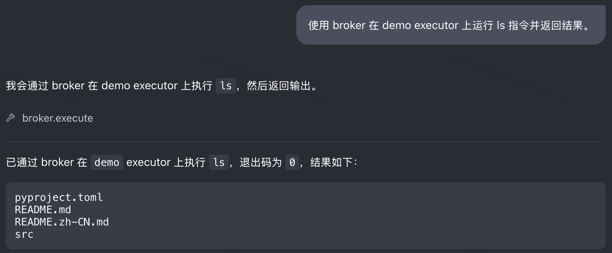
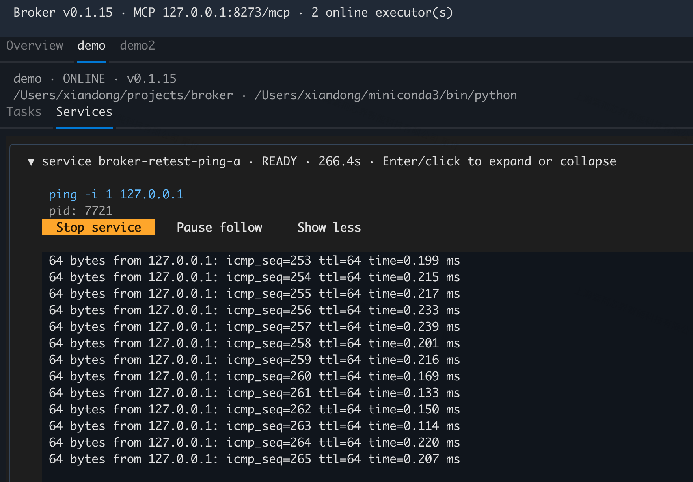

# Broker

English | [简体中文](README.zh-CN.md)

Broker provides a small execution broker for agents. An `Executor`
runs on a specific server, in a specific working directory and Python
environment. The agent connects to the `Execution Broker` through MCP and
selects an executor for command execution.

```text
Codex ── MCP / Streamable HTTP ──→ Central Broker
                                      ↑
                                      │ WebSocket
                                      ├── Server A: executor
                                      ├── Server B: executor
                                      └── Server C: multiple executors
```

Run one central broker and connect all executors to it. Starting or stopping a
executor does not start or stop the broker; the broker keeps running even when
no executors are connected.

## Install

Install directly from GitHub in the Python environment used to run the broker
or an executor (Git must be installed):

```bash
python -m pip install git+https://github.com/hustzxd/broker.git
```

For local development, run the following from the repository root:

```bash
python -m pip install -e .
```

This installs the `broker` command and the MCP 2.x, WebSocket and YAML
dependencies.

This project runs independently and does not require LocalEnv. Python 3.10 or
newer is required. You can also run the CLI with `python -m broker`.

Check the installed version:

```bash
broker --version
# broker v0.1.10
```

For each subsequent change, increment the patch version in
`src/broker/version.py` (for example, `0.1.10` to `0.1.11`). The CLI and package
metadata use this same version source.

## Configuration

The default configuration file is:

```text
~/.broker/config.yaml
```

Create it with the broker and executor settings:

```yaml
broker:
  key: "<automatically generated random key>"
  mcp_host: 0.0.0.0
  mcp_port: 8273
  executor_host: 0.0.0.0
  executor_port: 8272
  max_log_bytes: 1048576
  max_completed_tasks: 100
  max_completed_services: 100
  max_pending_tasks: 32

executor:
  broker_url: ws://broker-host:8272
```

If the file does not exist, `broker` and `broker executor` create
it with local default values and a random 256-bit `broker.key`. Existing keys
are preserved. Starting the broker with an older config adds a missing key
atomically, preserving other settings (YAML comments may be reformatted).

On startup, the default `~/.broker` directory is restricted to mode `700` and
its `config.yaml` to `600`, including existing installations. Default paths
that are symbolic links are rejected to avoid changing an unrelated target.
New custom configuration files use mode `600`; custom configs used to store a
broker key are also restricted to `600`. Existing parent directory permissions
are preserved.

The `broker` section controls the MCP HTTP service and the internal WebSocket
service. The `executor` section configures the central broker connection.

For a multi-server deployment with the central broker at `192.0.2.10`, use:

```yaml
broker:
  mcp_host: 0.0.0.0
  mcp_port: 8273
  executor_host: 0.0.0.0
  executor_port: 8272
executor:
  broker_url: ws://192.0.2.10:8272
```

`broker.mcp_host` and `broker.mcp_port` control the MCP HTTP listener;
`broker.executor_host` and `broker.executor_port` control the Executor WebSocket
listener. `0.0.0.0` listens on all interfaces of the broker machine.
`executor.broker_url` is the reachable central broker address used by executors.
The `broker` section is used when running `broker`; the `executor` section is
used when running `broker executor`, so the same configuration can be shared
across servers. Start `broker` only on the central server.

Command-line arguments override values from the configuration file. Another
configuration file can be selected with `--config` (before `executor` when
starting an executor):

```bash
broker --config /path/to/config.yaml
```

`broker.max_log_bytes` limits the retained stdout and stderr text for each task
or service, combined, to 1 MiB by default. It must be a positive integer and can
be overridden with `broker --max-log-bytes 2097152`. Existing configuration files
without this setting use the default. The limit counts UTF-8 text bytes, excludes
Python object overhead, and applies separately to each task or service rather
than to total broker memory. Old output is discarded first, preserving complete
UTF-8 characters; commands and services continue running when the limit is reached.

`max_completed_tasks` and `max_completed_services` retain the most recently
finished records in broker memory (100 each by default), including their bounded
logs. Oldest finished records are evicted first; active records are never evicted.
`max_pending_tasks` limits unfinished commands per executor (32 by default,
including the running command and queued commands); excess submissions return
`queue_full` without starting a command. All three settings must be positive
integers. History is not written to files and is lost when the broker restarts.

## Start The Broker

On the broker server:

```bash
broker
```

To override the configuration from the command line:

```bash
broker \
  --mcp-host 0.0.0.0 \
  --mcp-port 8273 \
  --executor-host 0.0.0.0 \
  --executor-port 8272
```

The MCP URL is:

```text
http://<broker-host>:8273/mcp
```

Configure this URL in the agent or MCP client.

## Connect Codex

Start the broker separately, then run the following command on the machine
where Codex runs to register the MCP server:

```bash
codex mcp add broker --url http://127.0.0.1:8273/mcp
```

For a broker on another machine, replace `broker-host` with its IP address or
domain name (use the configured MCP port if it differs from `8273`):

```bash
codex mcp add broker --url http://broker-host:8273/mcp
```

The remote broker must listen on a reachable interface, for example with
`broker --mcp-host 0.0.0.0`. Use the MCP HTTP port (`8273`), rather than the Executor
WebSocket port (`8272`).

The command saves the server in Codex's global `~/.codex/config.toml`:

```toml
[mcp_servers.broker]
url = "http://127.0.0.1:8273/mcp"
bearer_token_env_var = "BROKER_KEY"
```

Set `BROKER_KEY` to the central broker's `broker.key` in the environment of the
process that starts Codex. For a terminal-based Codex on the same machine, read
the key without printing it or putting its value in shell history:

```bash
export BROKER_KEY="$(python -c 'from broker.config import load_config; print(load_config()["broker"]["key"])')"
codex
```

For a remote client, securely copy the central key into the client's secret
environment. Desktop applications must inherit this environment when launched;
exporting it in an unrelated terminal does not update a running application.
Alternatively configure the request header directly in the same TOML section:

```toml
http_headers = { Authorization = "Bearer <central broker key>" }
```

Choose one method. If using a literal header, restrict `~/.codex/config.toml` to
mode `600`. Codex automatically sends the bearer header on MCP requests; the
model's tool arguments are unchanged and the key does not belong in prompts.
OAuth login is not required. Missing or incorrect keys receive HTTP `401`.

Check the registration with:

```bash
codex mcp get broker
```

Restart Codex or reconnect the MCP server to load the configuration. Registering
the URL does not start the broker; keep the broker running separately. Start a
executor as described below before using command execution tools.

See the [official Codex MCP documentation](https://developers.openai.com/codex/mcp/).

## Start A Executor

Start the executor in the target working directory and Python environment. The
executor inherits both when it starts. By default, the command asks for a
executor name. Names must be non-empty and are supplied at startup, either
interactively or with `--executor-id`; they are not read from the configuration:

```bash
cd /data/project-a
conda activate train
broker executor
```

If the name is already used by another online executor, the command asks for a
different name and retries registration without restarting.

Commands run using the shell from the Executor environment's `$SHELL` setting,
falling back to `/bin/sh` when it is not available. To use zsh, start the
Executor from a zsh environment or set `SHELL=/bin/zsh`.

The executor can also be started with the Python executable from the target
environment:

```bash
cd /data/project-a
/opt/conda/envs/train/bin/broker executor
```

To override the configured executor values:

```bash
broker executor \
  --broker-url ws://broker-host:8272 \
  --executor-id gpu01-project-a
```

The broker port can be overridden without rewriting the URL (the host and
scheme come from `--broker-url` or `config.yaml`):

```bash
broker executor --port 9000 --executor-id gpu01-project-a
```

Executor handshakes also require `Authorization: Bearer <key>`. The executor
reads `BROKER_KEY` first, then `executor.key`, then local `broker.key`. On the
broker machine the generated local key works automatically. On another machine,
set `executor.key` to the central broker's key in its private config:

```yaml
executor:
  broker_url: ws://broker-host:8272
  key: "<central broker key>"
```

A remote executor's locally generated `broker.key` is unrelated to the central
key. Authentication failures exit without retrying. Keys travel only in request
headers and aren't included in executor listings or normal logs.

The executor retries transient connection failures, including at startup, and
reconnects after either a normal close or a network interruption. Retry delays
are 1, 2, 4, 8, 16 and then 30 seconds, capped at 30 seconds. A registered
connection lasting at least 30 seconds resets the delay. Logs show the address,
failure reason and retry delay; Ctrl-C stops retries. Invalid URLs and permanent
handshake errors exit instead of retrying. Registration replies have a 10-second
timeout.

Reconnections register the same executor name, directory and environment. If the
name is still occupied, the executor retries with backoff without prompting for
a new name. Name conflicts on the initial registration retain the interactive
rename behavior.

Each successful registration exchanges broker and executor package versions.
If they differ, both sides log a warning with their versions and an upgrade
command; a missing version from an older peer is reported as `unknown`.
The warning does not reject the connection or guarantee protocol compatibility.
Update the relevant Python environment on both machines, then restart broker
and executor:

```bash
python -m pip install --upgrade git+https://github.com/hustzxd/broker.git
```

When the broker detects a disconnected executor, its unfinished tasks become
terminal `lost` tasks with `returncode: null` and an error explaining that their
execution outcome is unknown. Existing output and cursors remain available, and
waiting `execute` calls return immediately. Completed tasks keep their results.
Tasks are never replayed automatically. The executor kills running task process
groups and discards queued commands before reconnecting.

Services still stop on disconnect: cleanup sends `SIGTERM`, waits up to 5 seconds,
then sends `SIGKILL` if necessary. Service readiness monitors are cancelled, and
the broker marks active service records as `failed`, with an error explaining
that the outcome is unknown, and retains their logs under the history limit. Service survival
and state recovery across reconnects are not implemented. Task history is held
only in broker memory; restarting the broker loses that history.

## Use Broker In Codex

For concurrent task and service logs, select a local output mode:

```bash
broker executor --executor-id demo --output-mode prefixed
```

`--output-mode` overrides `executor.output_mode` in YAML (`raw` by default).
`raw` preserves original output, including carriage-return progress updates.
`prefixed` displays `[task <short-id> stdout]` or `[svc <name> stderr]` labels.
Partial lines stream immediately; prefixes aren't repeated across read chunks
unless another source or a status message interrupts the line. Carriage-return
progress updates become separate labeled lines in prefixed mode. Both modes
forward the original output to the broker without labels or added newlines.

Each received command displays `QUEUED`, and its start displays `RUNNING` and
the elapsed time since receipt at the executor. A command may start immediately
after its queue notice. Commands cancelled before launch don't display `RUNNING`.

The executor terminal starts status messages on a new line even when process
output has no trailing newline. Cancelled commands display `CANCELLED` with the
reason and exit code; queued cancellations display `before launch`. Service
startup and monitoring failures print their reasons locally. Process stdout and
stderr retain their original text and colors; stderr isn't automatically colored
red. These presentation changes do not modify output sent to the broker.

After starting the central broker and configuring its MCP connection in Codex,
start an executor in the directory you want to inspect:

```bash
cd /data/project-a
broker executor --executor-id demo
```

Keep the broker and executor running, then enter this prompt in Codex:

```text
Use broker to run ls on the demo executor and return the result.
```

Codex can check that the executor is online with `list_executors`, then call
`execute`:

```text
execute(executor_id="demo", command="ls")
```

The command runs in the directory where the demo executor was started. Codex
uses the actual result to report the directory contents and exit code.

Codex calls broker and displays the `ls` result:



The executor terminal shows the command, output and exit code:



You can also ask for online executors or a more detailed directory listing:

```text
Use broker to list online executors, including their names, working directories and Python paths.
```

```text
Use broker to run pwd and ls -la on the demo executor. Return the working directory, file listing and exit code.
```

When multiple executors are connected, specify the executor name in your prompt
to identify where the command should run.

## MCP Tools

The broker exposes these tools to the agent:

### `list_executors`

Lists currently connected executors, including their executor ID,
working directory, Python executable and version (when reported by the peer).

### `execute`

Runs a one-shot shell command and waits for its result. The default timeout is
60 seconds:

```text
execute(
  executor_id="gpu01-project-a",
  command="bash train.sh"
)
```

Completed commands return their output and return code directly. If the
command exceeds the timeout, the result contains a `task_id` with status
`submitted` (waiting to start), `running`, or `cancelling`; use `get_task` to query it:

```text
get_task(task_id="<task-id>")
```

The timeout can be changed per call:

```text
execute(
  executor_id="gpu01-project-a",
  command="bash long_test.sh",
  timeout=300
)
```

### `list_tasks`

List unfinished commands, optionally filtered by executor. Add
`include_completed=True` to include retained terminal records:

```text
list_tasks(executor_id="gpu01-project-a", include_completed=True)
```

Entries contain metadata without output. Task metadata includes `submitted_at`,
`started_at` and `finished_at`, as Unix timestamps from the broker clock.
Times not yet reached are `null`. An executor reports `running` only after its
process starts; before that the task stays `submitted`. Terminal states are
`completed`, `cancelled`, `failed` and `lost`. Query logs using `get_task`.

### `get_task`

Returns the task status, stdout, stderr and return code for a command that has
not completed before its `execute` timeout:

```text
get_task(task_id="<task-id>")
```

The task response contains `output`, `truncated` and `next_cursor`. To poll only
new output, pass the previous response's `next_cursor` as `cursor`:

```text
get_task(task_id="<task-id>", cursor=1234)
```

Omit `cursor` or use `0` to read from the earliest retained output. Cursors are
UTF-8 byte offsets in the combined stdout/stderr stream for that task; reuse the
returned cursor rather than calculating it. `truncated: true` means output after
the requested position has already been discarded. The response returns the
remaining output and advances `next_cursor` to the current end. A caught-up poll
returns an empty `output` with `truncated: false`. Negative or future cursors and
offsets within a UTF-8 character produce an `invalid_cursor` tool error.
Completed `execute` responses include the same log metadata.

### `cancel_task`

Cancel a running or queued command:

```text
cancel_task(task_id="<task-id>")
```

Running commands execute in independent process groups. Cancellation immediately
sends `SIGKILL` to the whole group, including child processes in that group.
Queued commands are cancelled without being started. Commands still run serially
within each executor; the executor continues receiving cancellation and service
control requests while a command runs.

The response may be `cancelling`; use `get_task` to confirm the final `cancelled`
status and retrieve output captured before cancellation. A command cancelled
before launch has a `null` return code. Cancelling a finished task returns its
existing result. An unknown task or an offline executor produces a tool error.
The `execute` timeout continues to limit only the wait and does not cancel a task.

## Long-Running Services

Use the service tools for processes that are expected to keep running, such as
vLLM or TensorBoard. Services have their own lifecycle and are not treated as
completed shell commands.

Start a service:

```text
start_service(
  executor_id="gpu01-project-a",
  name="vllm-qwen",
  command="python -m vllm.entrypoints.openai.api_server --model /models/Qwen --port 8000",
  ready_check={"type": "tcp", "port": 8000},
  startup_timeout=180
)
```

The result contains a `service_id`. Use the following tools to manage it:

```text
get_service(service_id="<service-id>")
get_service_logs(service_id="<service-id>", tail=200)
list_services(executor_id="gpu01-project-a")
stop_service(service_id="<service-id>")
```

`get_service_logs` returns an object with `logs`, `truncated` and `next_cursor`
(previously it returned a bare list). Without a cursor, `tail` selects the last
200 output chunks by default, not lines; `tail=0` returns no chunks. `truncated`
also reports output omitted by `tail`. For incremental polling, pass the returned
`next_cursor` as `cursor`; an explicit cursor overrides `tail` and returns all
retained output since that position:

```text
get_service_logs(service_id="<service-id>", cursor=1234)
```

Cursor and byte-limit behavior match task output. These settings govern retained
broker logs; output printed directly in the executor terminal is unaffected.

Supported service states are `starting`, `ready`, `stopping`, `stopped` and
`failed`. Readiness checks currently support TCP port availability and are
performed inside the Executor machine.

Stopping a service sends `SIGTERM` to its process group and escalates to
`SIGKILL` after 5 seconds, while the executor remains responsive. An explicitly
stopped service ends as `stopped`, even if its signal exit code is nonzero.
Repeated stops return the current state. Finished services and their final logs
remain queryable until evicted; use `list_services(include_inactive=True)` to
list them. Startup/monitoring errors become `failed` with an error message.
TCP checks require a port from 1 to 65535 and an optional nonempty host;
`startup_timeout` must be positive. Invalid settings are rejected before launch.

## Connection Diagnostics

```bash
broker doctor
broker doctor --url https://broker.example.com/mcp
broker --config /path/to/config.yaml doctor
```

Uses `BROKER_KEY` or the existing `broker.key` without modifying configuration.
The default URL comes from the configured MCP listener (`0.0.0.0`/`::` map to
loopback). Success prints server version and discovered tool names. Failure
distinguishes authentication (401/403), connectivity, timeout, HTTP and protocol
errors, and exits with status 1. Credentials and raw error bodies aren't printed.
This tests the supplied credentials directly; it does not inspect or reload a
Codex client's configuration or its existing session.

## Network Requirements

The broker server must accept:

- MCP HTTP traffic on `mcp_port`, default `8273`.
- Executor WebSocket traffic on `executor_port`, default `8272`.

The executor server must be able to connect to the broker's Executor WebSocket
address.

Both entrances require the shared key. Every holder has full access to all
executors, tasks and services; this version doesn't provide per-user permissions.
Bearer authentication does not encrypt traffic. Use HTTPS/WSS via a TLS reverse
proxy or an encrypted SSH/VPN tunnel for remote access, and prevent bypassing the
proxy through the raw ports. A private config doesn't isolate processes running
under the same operating-system user.

To rotate the key, replace `broker.key`, restart the broker and update/restart
clients and executors. If `BROKER_KEY` is set, it overrides the configured key
for the broker as well. Keys are never printed automatically. Existing clients
without a key must be updated after upgrading to this version.

## Development Checks

Run the basic syntax and import checks from the repository root:

```bash
PYTHONPATH=src python -m py_compile src/broker/*.py
PYTHONPATH=src python -m unittest discover -s tests -v
```
