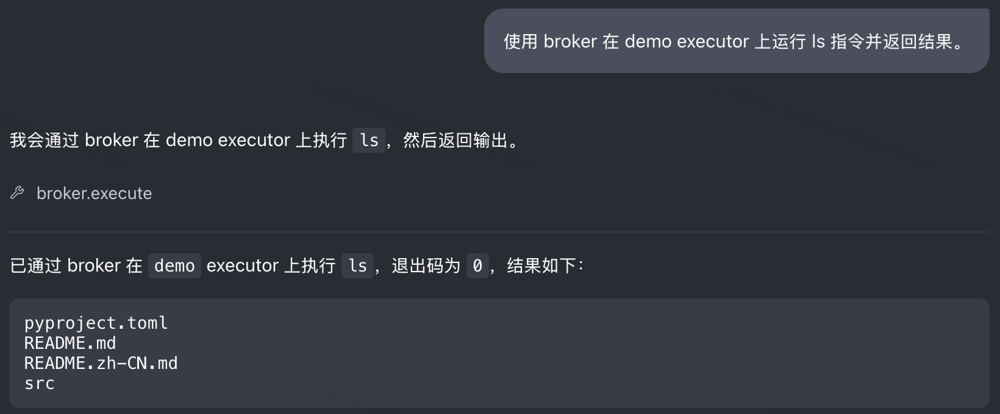
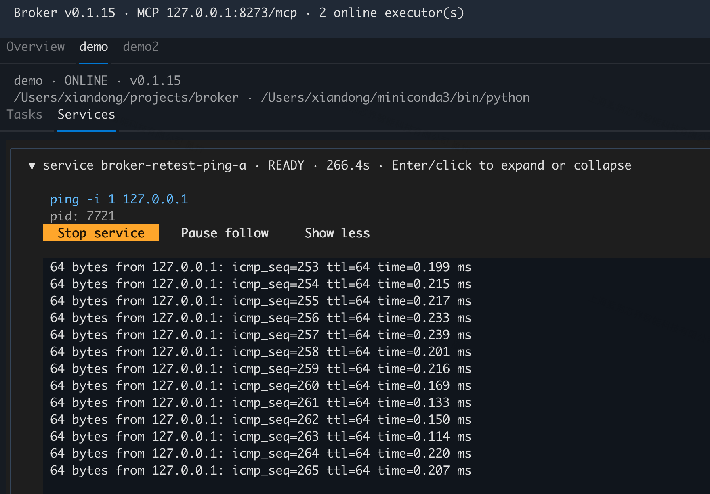

# Broker

[English](README.md) | 简体中文

Broker 为 AI Agent 提供命令执行服务。每个执行器（Executor）运行在特定服务器、工作目录和 Python 环境中。Agent 通过 MCP 连接中心 Broker，选择 executor 执行命令。

```text
Codex ── MCP / Streamable HTTP ──→ 中心 Broker
                                      ↑
                                      │ WebSocket
                                      ├── 服务器 A 的 executor
                                      ├── 服务器 B 的 executor
                                      └── 服务器 C 的多个 executor
```

只需运行一个中心 broker，所有 executor 都连接到它。启动或关闭 executor 不会启动或关闭 broker；即使所有 executor 都断开，broker 仍继续运行。

## 安装

在运行 broker 或 executor 的 Python 环境中直接从 GitHub 安装，需要预先安装 Git：

```bash
python -m pip install git+https://github.com/hustzxd/broker.git
```

本地开发时，在仓库根目录执行：

```bash
python -m pip install -e .
```

安装后会提供 `broker` 命令，并安装 MCP 2.x、WebSocket 和 YAML 依赖。

本项目独立运行，无需安装 LocalEnv。需要 Python 3.10 或更新版本，也可以使用 `python -m broker` 运行命令行工具。

查看安装版本：

```bash
broker --version
# broker v0.1.10
```

后续每次修改后，递增 `src/broker/version.py` 中的补丁版本号，例如从 `0.1.10` 升到 `0.1.11`。命令行和安装包元数据使用同一份版本定义。

## 配置

默认配置文件路径：

```text
~/.broker/config.yaml
```

配置示例：

```yaml
broker:
  key: "<自动生成的随机密钥>"
  mcp_host: 0.0.0.0
  mcp_port: 8273
  executor_host: 0.0.0.0
  executor_port: 8272
  max_log_bytes: 1048576
  max_completed_tasks: 100
  max_completed_services: 100
  max_pending_tasks: 32

executor:
  broker_url: ws://broker-host:8272
```

如果配置文件不存在，运行 `broker` 或 `broker executor` 时会自动创建，默认监听本机回环地址 `127.0.0.1`，并生成 256 位随机 `broker.key`。已有 Key 会保留；启动中心 broker 时，旧配置中缺失的 Key 会原子补齐，其他设置保留（YAML 注释和排版可能变化）。上面的示例使用 `0.0.0.0`，适合需要接受其他机器连接的中心服务。

启动时会将默认 `~/.broker` 目录权限设为 `700`，将其中的 `config.yaml` 设为 `600`，已有安装也会自动修正权限。默认目录或文件是符号链接时会拒绝使用，避免修改无关目标。新建的自定义配置文件使用 `600`；用于保存 broker Key 的已有自定义配置也会收紧到 `600`，现有父目录权限保持不变。

`broker` 部分配置 MCP HTTP 服务和 Executor WebSocket 服务；`executor` 部分配置中心 broker 的连接地址。

如果中心 broker 位于 `192.0.2.10`，多服务器部署可以使用：

```yaml
broker:
  mcp_host: 0.0.0.0
  mcp_port: 8273
  executor_host: 0.0.0.0
  executor_port: 8272
executor:
  broker_url: ws://192.0.2.10:8272
```

| 配置项 | 含义 |
|---|---|
| `broker.mcp_host` / `mcp_port` | MCP HTTP 的监听地址和端口，供 Codex 等 MCP 客户端连接 |
| `broker.executor_host` / `executor_port` | Executor WebSocket 的监听地址和端口，供 executor 连接 |
| `executor.broker_url` | executor 使用的中心 broker 地址 |

`0.0.0.0` 表示监听 broker 所在机器的所有 IPv4 网络接口。executor 应连接中心服务器可访问的 IP 或域名。

执行 `broker` 时读取 `broker` 部分，执行 `broker executor` 时读取 `executor` 部分，因此同一份配置可以分发到多台服务器。只在中心服务器启动 `broker`，其他服务器启动 executor。

命令行参数优先于配置文件。可以使用 `--config` 指定其他配置文件，启动 executor 时需将其放在 `executor` 子命令之前：

```bash
broker --config /path/to/config.yaml
```

`broker.max_log_bytes` 限制每个任务或服务保留的 stdout 和 stderr 文本总量，默认 1 MiB，必须为正整数。可使用 `broker --max-log-bytes 2097152` 覆盖；已有配置未设置此项时使用默认值。上限按 UTF-8 文本字节计数，不包含 Python 对象开销，分别作用于每个任务或服务，不是 broker 的总内存上限。达到上限后优先丢弃旧输出，并保留完整 UTF-8 字符，命令和服务会继续运行。

`max_completed_tasks` 和 `max_completed_services` 分别限制内存中保留的最近已结束任务和服务数量，默认各 100 个，包含其有字节上限的日志。优先淘汰最早结束的记录，不淘汰活跃记录。`max_pending_tasks` 限制每个 executor 的未完成命令数，默认 32 个（包含运行中与排队中的命令）；超出时返回 `queue_full`，不启动命令。三项配置均须为正整数。历史不写入文件，重启 broker 后丢失。

## 启动中心 Broker

在中心服务器上执行：

```bash
broker
```

也可以通过命令行覆盖配置：

```bash
broker \
  --mcp-host 0.0.0.0 \
  --mcp-port 8273 \
  --executor-host 0.0.0.0 \
  --executor-port 8272
```

MCP 服务地址为：

```text
http://<broker-host>:8273/mcp
```

将该地址配置到 Agent 或 MCP 客户端中。

## 接入 Codex

先单独启动 broker，再在运行 Codex 的机器上注册 MCP 服务。

如果 Codex 和 broker 在同一台机器：

```bash
codex mcp add broker --url http://127.0.0.1:8273/mcp
```

如果 broker 在另一台机器，将 `broker-host` 替换为中心服务器的 IP 或域名。如果修改了 MCP 端口，也需要替换 `8273`：

```bash
codex mcp add broker --url http://broker-host:8273/mcp
```

远程 broker 需要监听其他机器可访问的网络接口，例如使用 `broker --mcp-host 0.0.0.0`。Codex 连接的是 MCP HTTP 端口 `8273`，executor 连接的是 WebSocket 端口 `8272`。

该命令会将服务写入 Codex 的全局配置 `~/.codex/config.toml`：

```toml
[mcp_servers.broker]
url = "http://127.0.0.1:8273/mcp"
bearer_token_env_var = "BROKER_KEY"
```

将中心 broker 的 `broker.key` 放入启动 Codex 的进程环境变量 `BROKER_KEY`。同机从终端启动 Codex 时，可以直接读取，避免打印 Key 或将其值写入 shell 历史：

```bash
export BROKER_KEY="$(python -c 'from broker.config import load_config; print(load_config()["broker"]["key"])')"
codex
```

远程客户端需安全传递中心 Key，并设置到客户端环境中。桌面应用必须在启动时继承该变量；在其他终端执行 `export` 不会更新已经运行的应用。也可以在同一个 TOML 配置段中直接设置请求头：

```toml
http_headers = { Authorization = "Bearer <中心 broker 的 Key>" }
```

两种方式选一种即可。直接保存请求头时，将 `~/.codex/config.toml` 权限设为 `600`。Codex 会自动在 MCP 请求中携带 Bearer 请求头，模型调用工具时无需添加参数，也无需在提示词中提供 Key。不需要 OAuth 登录。缺失或错误 Key 会收到 HTTP `401`。

检查配置：

```bash
codex mcp get broker
```

重启 Codex 或重新连接 MCP 服务以加载配置。注册地址不会启动 broker，仍需单独保持 broker 运行。使用命令执行工具前，还需要按下文启动至少一个 executor。

参考 [Codex 官方 MCP 文档](https://developers.openai.com/codex/mcp/)。

## 启动 Executor

在目标工作目录和 Python 环境中启动 executor，它会继承启动时的目录和环境。默认会提示输入 executor 名称，名称不能为空。名称由用户在启动时输入，或通过 `--executor-id` 指定，不从配置文件读取：

```bash
cd /data/project-a
conda activate train
broker executor
```

如果名称已被其他在线 executor 占用，会提示输入其他名称，并在同一次连接中重新注册，无需重启。

命令使用 executor 环境中的 `$SHELL`，不可用时回退到 `/bin/sh`。需要使用 zsh 时，可以从对应环境启动 executor，或设置 `SHELL=/bin/zsh`。

也可以直接使用目标 Python 环境中安装的命令启动：

```bash
cd /data/project-a
/opt/conda/envs/train/bin/broker executor
```

通过命令行覆盖 executor 配置：

```bash
broker executor \
  --broker-url ws://broker-host:8272 \
  --executor-id gpu01-project-a
```

只修改 broker 的 WebSocket 端口时，无需重写整个 URL；主机和协议仍取自 `--broker-url` 或配置文件：

```bash
broker executor --port 9000 --executor-id gpu01-project-a
```

Executor 握手也需要 `Authorization: Bearer <key>`。executor 按顺序读取环境变量 `BROKER_KEY`、`executor.key`、本机 `broker.key`。同机运行时可直接使用自动生成的 Key；其他机器需要将 `executor.key` 设置为中心 broker 的 Key：

```yaml
executor:
  broker_url: ws://broker-host:8272
  key: "<中心 broker 的 Key>"
```

远程机器本地自动生成的 `broker.key` 与中心 Key 不相同。认证失败会直接退出，不会重试。Key 仅通过请求头传输，不会出现在 executor 列表或正常日志中。

executor 会自动重试临时连接失败，包括启动时无法连接中心 broker，以及运行期间正常关闭或网络中断。重试间隔依次为 1、2、4、8、16、30 秒，之后保持 30 秒；注册成功的连接持续至少 30 秒后，退避会重置。日志显示目标地址、失败原因和重试间隔，按 Ctrl-C 可退出。无效 URL 和永久握手错误会直接退出。等待注册回复的超时为 10 秒。

重连时使用原 executor 名称、目录和环境。如果名称仍被占用，会继续按退避重试，不再提示改名；首次注册发生名称冲突时，仍保留交互改名行为。

每次注册成功时会交换 broker 和 executor 的安装版本。版本不一致时，双方日志会显示警告、双方版本及升级命令；旧版本未提供版本号时显示为 `unknown`。警告不会拒绝连接，也不代表不同版本的协议一定兼容。请分别在两端实际使用的 Python 环境中升级，然后重启 broker 和 executor：

```bash
python -m pip install --upgrade git+https://github.com/hustzxd/broker.git
```

broker 检测到 executor 断线后，会将其未完成任务标记为终态 `lost`，退出码为 `null`，并在错误信息中注明真实执行结果未知。已有输出和游标仍可查询，等待中的 `execute` 会立即返回；已结束任务保留原结果。旧任务不会自动重放。executor 会在重连前终止运行中的任务进程组，并丢弃排队命令。

服务仍在断线后停止：清理时发送 `SIGTERM`，最多等待 5 秒，必要时发送 `SIGKILL`；同时取消服务就绪监控。broker 将活跃服务标记为 `failed`，注明真实结果未知，按历史数量上限保留状态和日志。本次不实现服务跨断线存活和状态恢复。任务历史仅保存在 broker 内存中，重启 broker 后无法查询旧任务。

## 在 Codex 中使用

多个任务和服务混合输出时，可选择带来源标签的本地显示模式：

```bash
broker executor --executor-id demo --output-mode prefixed
```

`--output-mode` 优先于 YAML 中的 `executor.output_mode`，默认 `raw`。`raw` 保留原始输出和回车进度更新；`prefixed` 显示 `[task <短ID> stdout]` 或 `[svc <名称> stderr]` 标签。半行输出立即显示，同一行跨读取块时不重复加前缀；其他来源或状态信息打断半行后，续写时重新加标签。带标签模式将 `\r` 进度更新显示为独立行。两种模式发送给 broker 的内容均保持原样，不含本地标签或补加的换行。

收到命令时显示 `QUEUED`，开始执行时显示 `RUNNING` 和从 executor 收到任务起的等待时长。没有排队等待的任务也会先显示接收提示，随后立即开始；启动前取消的任务不会显示 `RUNNING`。

即使命令输出末尾没有换行，executor 终端的状态信息也会另起一行。取消的命令显示 `CANCELLED`、原因和退出码，排队中取消会显示 `before launch`；服务启动或监控失败会直接打印原因。stdout/stderr 保留程序原始文本和颜色，stderr 不再自动全部标红。这些本地显示调整不会修改发送给 broker 的输出。

启动中心 broker、完成 Codex MCP 配置后，在要查看的目录中启动一个 executor：

```bash
cd /data/project-a
broker executor --executor-id demo
```

保持 broker 和 executor 运行，在 Codex 对话框中输入：

```text
使用 broker 在 demo executor 上运行 ls 指令并返回结果。
```

Codex 可以通过 `list_executors` 确认执行器在线，再调用 `execute`：

```text
execute(executor_id="demo", command="ls")
```

命令会在 demo executor 启动时的工作目录中执行，Codex 根据实际返回结果展示目录内容和退出码。

Codex 调用 broker 并展示 `ls` 结果：



Executor 终端同步显示命令、输出和退出码：



也可以直接请求查看在线执行器，或指定更详细的目录输出：

```text
使用 broker 列出当前在线的 executor，显示名称、工作目录和 Python 路径。
```

```text
使用 broker 在 demo executor 上运行 pwd 和 ls -la，返回工作目录、文件列表和退出码。
```

如果有多个 executor，请在提示词中指定名称，以明确命令的执行位置。

## MCP 工具

Broker 向 Agent 提供以下工具。

### `list_executors`

列出当前在线的 executor，包括 executor ID、工作目录、Python 可执行文件路径和版本号（对端提供时）。

### `execute`

执行一次性 Shell 命令并等待结果，默认等待 60 秒：

```text
execute(
  executor_id="gpu01-project-a",
  command="bash train.sh"
)
```

命令完成后直接返回输出和退出码。如果超过等待时间，返回当前状态 `submitted`（等待启动）、`running` 或 `cancelling`，并包含 `task_id`，可通过 `get_task` 查询。超时返回不会终止命令：

```text
get_task(task_id="<task-id>")
```

每次调用可以单独设置等待时间：

```text
execute(
  executor_id="gpu01-project-a",
  command="bash long_test.sh",
  timeout=300
)
```

### `list_tasks`

列出未完成命令，可按 executor 筛选；设置 `include_completed=True` 可包含仍保留的终态记录：

```text
list_tasks(executor_id="gpu01-project-a", include_completed=True)
```

列表只包含元数据，不返回输出。任务元数据包含 `submitted_at`、`started_at`、`finished_at`，使用 broker 时钟的 Unix 时间戳，尚未发生的时间为 `null`。executor 在进程实际启动后才上报 `running`，之前保持 `submitted`。终态包括 `completed`、`cancelled`、`failed`、`lost`，日志通过 `get_task` 查询。

### `get_task`

查询已提交任务的状态、标准输出、标准错误和退出码，适用于未在 `execute` 等待时间内完成的命令：

```text
get_task(task_id="<task-id>")
```

任务结果包含 `output`、`truncated` 和 `next_cursor`。轮询时，将上一次返回的 `next_cursor` 作为 `cursor` 传入，即可只读取新增输出：

```text
get_task(task_id="<task-id>", cursor=1234)
```

不传 `cursor` 或传 `0` 时，从最早保留的输出开始读取。游标是该任务 stdout/stderr 合并输出中的 UTF-8 字节偏移，请直接使用返回值，不必自行计算。`truncated: true` 表示请求位置之后的部分输出已被丢弃；本次返回仍保留的内容，并将 `next_cursor` 推进至当前末尾。没有新增输出时，`output` 为空且 `truncated: false`。负数、超出当前末尾或落在 UTF-8 字符内部的游标会返回 `invalid_cursor` 工具错误。已完成的 `execute` 结果也包含这些日志信息。

### `cancel_task`

取消正在运行或排队中的命令：

```text
cancel_task(task_id="<task-id>")
```

运行中的命令使用独立进程组，取消时立即向整个进程组发送 `SIGKILL`，包括同一进程组内的子进程。排队中的命令会直接取消，不再启动。同一个 executor 内的普通命令仍串行执行；命令运行期间，executor 可以继续接收取消和服务控制指令。

返回状态可能为 `cancelling`，可通过 `get_task` 确认最终的 `cancelled` 状态，并读取取消前已捕获的输出。启动前取消的任务退出码为 `null`。取消已结束的任务会返回原结果；任务不存在或 executor 已离线时返回工具错误。`execute` 的超时参数仍只限制等待时间，不会自动取消任务。

## 长期运行的服务

对于 vLLM、TensorBoard 等需要持续运行的进程，使用服务管理工具。服务拥有独立的生命周期。

启动服务：

```text
start_service(
  executor_id="gpu01-project-a",
  name="vllm-qwen",
  command="python -m vllm.entrypoints.openai.api_server --model /models/Qwen --port 8000",
  ready_check={"type": "tcp", "port": 8000},
  startup_timeout=180
)
```

返回结果包含 `service_id`，可通过以下工具查询和管理：

```text
get_service(service_id="<service-id>")
get_service_logs(service_id="<service-id>", tail=200)
list_services(executor_id="gpu01-project-a")
stop_service(service_id="<service-id>")
```

`get_service_logs` 现在返回包含 `logs`、`truncated` 和 `next_cursor` 的对象，替代原来的裸列表。不传游标时，`tail` 默认选择最后 200 个输出块，而非 200 行；`tail=0` 返回空日志。被 `tail` 省略的输出也会使 `truncated` 为真。增量轮询时，将上次的 `next_cursor` 作为 `cursor` 传入；显式游标优先于 `tail`，返回该位置之后仍保留的全部输出：

```text
get_service_logs(service_id="<service-id>", cursor=1234)
```

服务日志的游标和字节上限规则与任务输出一致。这些设置控制 broker 保留的日志，不影响 executor 终端直接打印的输出。

服务状态包括 `starting`、`ready`、`stopping`、`stopped` 和 `failed`。就绪检查目前支持 TCP 端口检查，在 executor 所在机器上执行。

停止服务时向进程组发送 `SIGTERM`，5 秒后仍未退出则发送 `SIGKILL`，等待期间 executor 仍可接收指令。主动停止的服务最终为 `stopped`，即使信号退出码非零；重复停止返回当前状态。终态服务和最后日志保留至被淘汰，可通过 `list_services(include_inactive=True)` 查看。启动或监控异常会变为 `failed` 并附原因。TCP 检查需要 1 至 65535 的端口和可选的非空主机名，`startup_timeout` 必须为正数，无效参数在启动前拒绝。

## 连接诊断

```bash
broker doctor
broker doctor --url https://broker.example.com/mcp
broker --config /path/to/config.yaml doctor
```

使用环境变量 `BROKER_KEY` 或已有 `broker.key`，不会修改配置。默认 URL 根据 MCP 监听地址构造，`0.0.0.0` 和 `::` 转为回环地址。成功时返回服务端版本和工具名称；失败时区分认证（401/403）、连接、超时、HTTP 和协议错误，退出码为 1。不打印凭证或原始错误正文。该命令直接验证所提供的凭证，不读取或重载 Codex 客户端配置及其已有会话。

## 网络要求

中心服务器需要允许以下连接：

- MCP HTTP：`mcp_port`，默认 `8273`。
- Executor WebSocket：`executor_port`，默认 `8272`。

executor 所在服务器必须能够访问中心 broker 的 Executor WebSocket 地址。

两个入口都需要共享 Key，持有者拥有所有 executor、任务和服务的操作权限；本版本不区分用户权限。Bearer 认证不加密流量，远程访问需通过 TLS 反向代理使用 HTTPS/WSS，或使用加密 SSH/VPN 隧道，并避免通过原始端口绕过代理。配置目录权限不能隔离以同一个操作系统用户运行的进程。

轮换 Key 时修改 `broker.key`、重启中心 broker，并更新和重启客户端与 executor。环境变量 `BROKER_KEY` 对中心 broker 同样生效，优先于配置值。程序不会自动打印 Key。升级后，已有无 Key 的客户端需要同步配置。

## 开发检查

在仓库根目录执行基本语法检查：

```bash
PYTHONPATH=src python -m py_compile src/broker/*.py
PYTHONPATH=src python -m unittest discover -s tests -v
```
